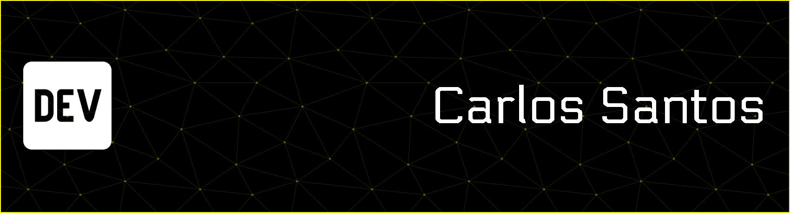

  
  
  <h1>Olá, eu sou o Carlos! ✌️</h1>
  
Estudante de Análise e Desenvolvimento de Sistemas no IFSP | Desenvolvedor Fullstack | Produtor Musical

 

## 👨‍💻 Sobre Mim
- 🎓 Cursando **Análise e Desenvolvimento de Sistemas** no IFSP Campus Bragança Paulista.
- 💼 Atualmente atuando na área administrativa na Santher, com background técnico em eletrônica.
- 🚀 Foco no desenvolvimento Web Fullstack (React, TypeScript, Python, Flask) e automações.
- 🎵 Produtor musical independente e entusiasta da criação audiovisual nas horas vagas.

 

## 🛠️ Habilidades e Tecnologias

### 💻 Desenvolvimento Web e Software

  
  
  
  
  
  
  
  

### 🎨 Áudio e Design

  
  
  
  
  
  

 

## 📫 Conecte-se comigo

  

## 📊 GitHub Stats

  

